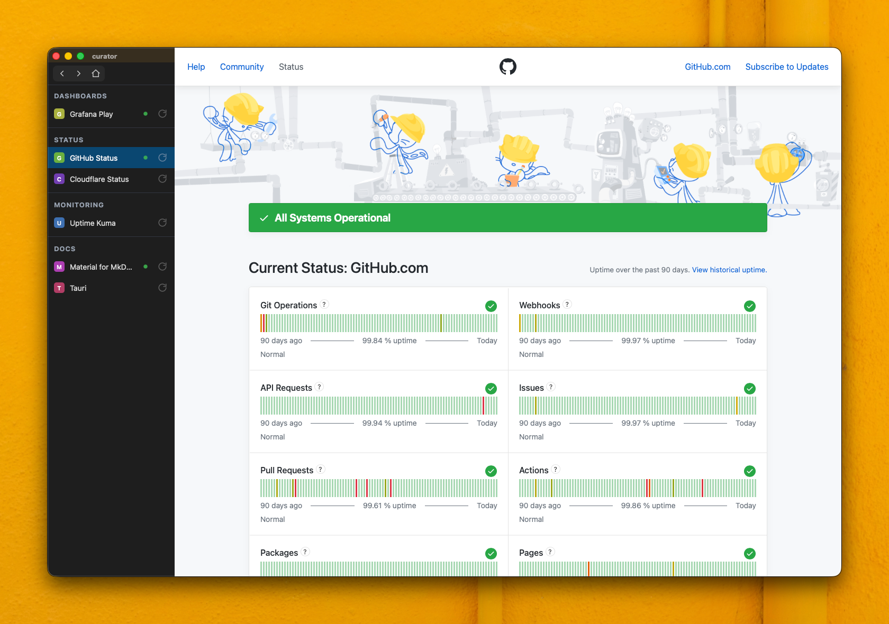

# curator

[](https://github.com/lockyc/curator/releases/latest)


[](LICENSE)

A home for the browser tabs you can't afford to lose — the webmail, chat and dashboards you keep
open all day — where nothing else can bury them. You list those tabs in a config file; curator
keeps each one in a sidebar, signed in, and sends every other link to your normal browser, so the
set never fills with clutter.



## Why

Important tabs (mail, calendar, dashboards) get buried in a sea of browser windows. Firefox
pinned tabs are the closest workaround, but the pinned window itself gets lost and keeping it
clean is constant manual work. curator gives keeper tabs a distinct, stable home that lives
outside the window pile and never accumulates cruft: curation is file-driven, everything else is
ephemeral.

## Install

**Download:** grab `curator-<version>-macos.zip` from the
[latest release](https://github.com/lockyc/curator/releases/latest), unzip, and move
`curator.app` to `/Applications`. Releases are signed and notarized.

**Or build from source** into `~/.curator` (needs Rust and the Xcode Command Line Tools); this
also seeds your config, and re-running it rebuilds from the latest source:

```sh
curl -fsSL https://raw.githubusercontent.com/lockyc/curator/main/install.sh | bash
```

curator updates itself: on launch, every 6 hours, and from **curator ▸ Check for Updates…**, an
*Update available* bar offers **Update & Relaunch**. Nothing installs without your approval, and
each update's signature is checked first.

## First run

Launch curator with no config and its home screen offers **Create a starter config**, which
writes a minimal one to `~/.config/curator/config.toml` (never over an existing file). For the
fuller two-window example, copy [`examples/config.toml`](examples/config.toml) there instead.
Edit the file and save: the sidebar reloads, and a malformed file keeps the last good config
running with an error banner. **Config ▸ Edit Config** opens it.

## Features

- **The config is the source of truth.** Each `[[window]]` opens a window of loose tabs and named
  groups. There is no in-app pin or unpin; you curate by editing the file.
- **Keeper tabs are home bases.** Wander within a session, then snap a tab back to its URL with ⌂
  (or by re-clicking it); every tab also resets on restart.
- **Outside links escape** to your default browser, leaving the tab where it was; links within
  the tab's own site stay in it. ⌘-click or middle-click opens any link outside.
- **Logins persist, and can be shared or kept apart.** Every tab shares one login store by
  default, so one sign-in covers a provider's related services. Give tabs a `session` name to
  separate accounts, or reuse one to share a login across windows.
- **Live tabs.** A `load_on_open` tab loads at launch, stays live in the background, fires
  native banners and rolls its unread count into the Dock badge. Other tabs stay lazy and quiet
  until you open them; the row's green dot unloads one.
- **Unread badges** come from the service's own badge count, a count in the page title, or a
  delivered notification. `unread = "count"` ignores a service's always-on "something is unread"
  marker (Discord's `•`), and `unread = "off"` silences a tab.
- **Windows** — **Window ▸ New Window…** (⌥⌘N) adds one, right-clicking a window's banner edits or
  deletes it, and a window with `open_on_start = false` waits in the **Window** menu. Closing the
  last open window quits curator.
- **Pop a tab out** (**⌘⇧O**) into its own window; the login survives, and closing the window
  returns the tab.
- **The sidebar** — search (**⌘⇧F**), collapse (**⌃⌘S**), ◀ ▶ ⟳ ⌂, a downloads list, and link
  destinations shown on hover. **⌘⇧[** / **⌘⇧]** cycle the loaded tabs and **⌘1–⌘9** jump to one.

## Configuration

`~/.config/curator/config.toml` (or the file `CURATOR_CONFIG` names). Loose tabs render first,
then each group. Common setups — several accounts of one web app, a notification hub, an
operator console, self-signed hosts — are in [docs/recipes.md](docs/recipes.md).

```toml
[[window]]
title = "Keepers"

  [[window.tab]]
  title = "Start"
  url   = "https://duckduckgo.com/"

  [[window.group]]
  name = "Dashboards"

    [[window.group.tab]]
    title        = "Grafana"
    url          = "https://play.grafana.org/"
    load_on_open = true
    reload_every = 5

[[window]]
title = "Comms"

  [[window.group]]
  name = "Chat"

    [[window.group.tab]]
    title        = "Mattermost"
    url          = "https://community.mattermost.com/"
    load_on_open = true
```

**Global**

| Key | Default | What it does |
|---|---|---|
| `dark_mode` | `false` | Force dark appearance so sites honouring `prefers-color-scheme` render dark. |
| `allow_insecure` | `[]` | Hosts whose self-signed/invalid TLS certs are accepted. Hot-reloads like the rest of the config. |
| `session` | none | App-wide default login store — the bottom of the session chain (`tab → window → this → built-in default`). **Cascades.** |
| `density` | `comfortable` | Chrome sizing: `comfortable` or `compact` (type + spacing scaled down for denser tab lists). Hot-reloads. |
| `sidebar_drag` | `true` | Whether the sidebar chrome is a window-move drag handle (drag the banner/empty list area). Hot-reloads. |
| `auto_update` | `true` | Check for a new release on launch and every 6 hours. `false` suppresses the automatic checks; **Check for Updates…** still works. Applies to windows opened after the change. |
| `format_on_save` | `false` | Reformat the config in curator's house style on each clean hot-reload (same as `curator fmt`). A reload that fails to parse leaves the file untouched. |
| `tab_digit_keys` | `jump` | What ⌘1/⌘2 do in the **Tab** menu: `jump` — ⌘1–⌘9 jump to a position; `cycle` — ⌘1 next, ⌘2 previous, jumps shift to ⌘3–⌘9. Hot-reloads. |

**`[[window]]`**

| Key | Default | What it does |
|---|---|---|
| `title` | *required* | Window title; unique across all windows. |
| `width` / `height` | `1500` / `1000` | First-run size in logical pixels; after that curator remembers each window's size and position. |
| `open_on_start` | `true` | `false` keeps the window closed at launch, opened on demand from the **Window** menu or home screen. Read at launch. |
| `open_on_launch` | `false` | `false` opens the first `load_on_open` tab, else a blank screen; `true` opens the first tab even if it isn't loaded. |
| `colour` | none | `#rgb` / `#rrggbb` accent for the window-name banner at the top of the sidebar. |
| `session` | inherited from global | Default login store for this window's tabs. **Cascades.** |

**`[[window.tab]]` / `[[window.group.tab]]`**

| Key | Default | What it does |
|---|---|---|
| `title` | *required* | Display label; duplicates are allowed. |
| `url` | *required* | The tab's canonical URL — where ⌂ home and a reset return it. |
| `load_on_open` | `false` | Load when the window opens and stay live in the background, so it fires banners and reports unread while inactive. |
| `reload_every` | none | Auto-refresh the canonical URL every N minutes (positive integer). |
| `unread` | `all` | Which unread signals badge the row: `all` — every signal, including a countless marker; `count` — only a real number (a delivered notification still dots the row); `off` — never. |
| `session` | inherited from window | Login store. Tabs sharing a value share a login, even across windows. Blank falls through the chain. |

**`[[window.group]]`**

| Key | Default | What it does |
|---|---|---|
| `name` | *required* | Section header in the sidebar; unique within its window. Holds `[[window.group.tab]]`s. |

The app binary, `/Applications/curator.app/Contents/MacOS/curator`, doubles as a config tool:
`curator validate [path]` prints the resolved windows and tabs, each tab's session and any
warnings, and `curator fmt [--check] [path]` rewrites a config in house style.

## Limits

curator renders with WKWebView (Safari's engine), so browser extensions are not available. A
popped-out tab reloads from its URL, so in-page state (scroll position, unsent form input)
doesn't carry across.

## Status

In use, `0.x`. What's next: [docs/FOLLOWUPS.md](docs/FOLLOWUPS.md).

## Related

curator's siblings share its sidebar, config and app shell:
[warden](https://github.com/lockyc/warden) — terminals,
[lector](https://github.com/lockyc/lector) — local doc sites,
[flotilla](https://github.com/lockyc/flotilla) — document workspaces.

## Development

Needs Rust and the Tauri CLI (`cargo install tauri-cli --version ^2`).

```sh
git clone https://github.com/lockyc/curator && cd curator
git config core.hooksPath .githooks   # once per clone: arms the pre-commit / pre-push hooks
just run      # launch against examples/config.toml (never touches your real config)
just test     # Rust tests
just gate     # the full pre-merge gate
just install  # build, install to /Applications, and relaunch
```

curator builds on three pinned shared crates — [chrome-core](https://github.com/lockyc/chrome-core)
(the sidebar), [config-core](https://github.com/lockyc/config-core) (config primitives) and
[shell-core](https://github.com/lockyc/shell-core) (app shell and release tooling). Working
against a local checkout of one, and the release process: [CLAUDE.md](CLAUDE.md).

## License

MIT — see [LICENSE](LICENSE).
